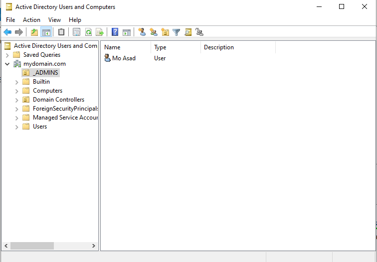
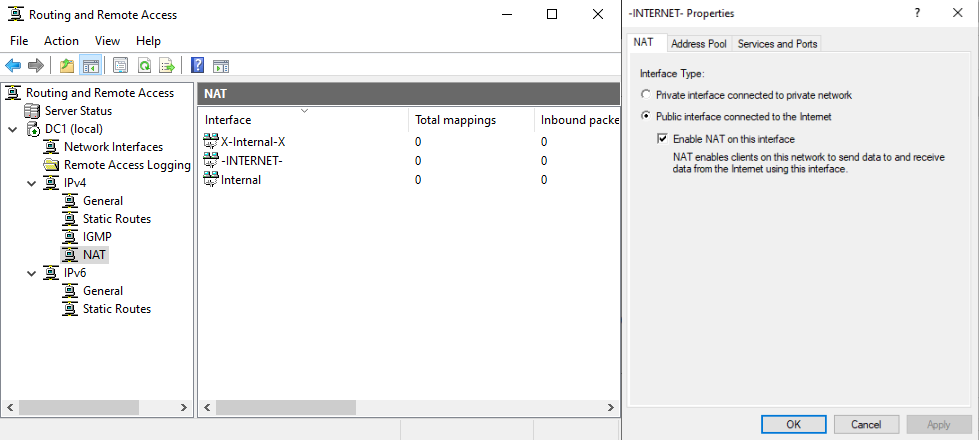
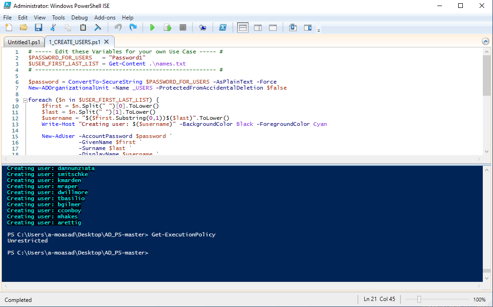
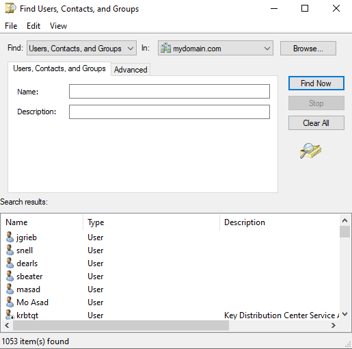
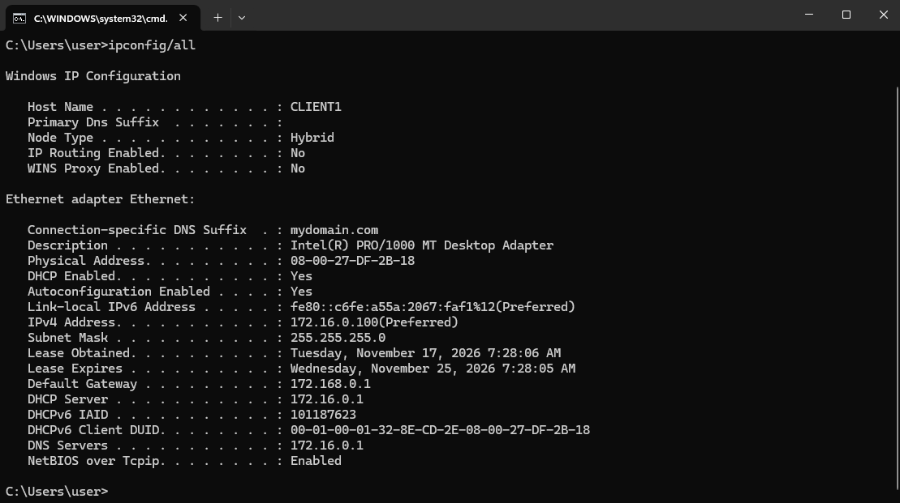

# Active Directory Home Lab – Windows Server 2022

## 1. Project Overview

This project demonstrates the deployment and configuration of an Active Directory home lab using Windows Server 2022 and Windows 11 in Oracle VirtualBox.

The purpose of this lab was to gain hands-on experience with Windows Server administration, Active Directory Domain Services, user management, network services, and domain authentication.

## 2. Lab Environment

The lab was built using the following virtual machines:

| Component | Configuration |
|---|---|
| Virtualization Platform | Oracle VirtualBox |
| Domain Controller | Windows Server 2022 |
| Server Name | DC1 |
| Client Machine | Windows 11 |
| Client Name | CLIENT1 |
| Active Directory Domain | mydomain.com |

**Screenshot – Virtual Machine Setup**

## 3. Network Configuration

Two network adapters were configured on the Domain Controller:

- **Internal:** Used for communication within the lab network.
- **External:** Used for external network connectivity.

The Internal adapter was assigned a static IPv4 address of `172.16.0.1`, while the External adapter obtained its IP configuration through DHCP.

IPv6 was enabled on both adapters.

**Screenshot – Network Adapters**

## 4. Server Configuration

The Windows Server machine was renamed to `DC1`.

Server Manager was used to review the server configuration, including the computer name and network adapter settings.

**Screenshot – Server Configuration**

## 5. Active Directory Installation and Domain Setup

Active Directory Domain Services (AD DS) was installed and configured on Windows Server 2022.

The server was promoted to a Domain Controller, establishing the Active Directory domain `mydomain.com`.

Active Directory Users and Computers (ADUC) was used to manage and view the domain structure.

**Screenshot – Active Directory Domain**

## 6. Organizational Unit and Administrator Configuration

An Organizational Unit named `_ADMINS` was created to organize administrative accounts.

An administrator account was placed inside the OU and assigned Domain Admin privileges.

This account was used to perform administrative tasks within the domain.

**Screenshot – Administrator OU**

## 7. Routing and NAT Configuration

Routing and Remote Access (RRAS) was configured to provide Network Address Translation (NAT).

The External interface was configured as the public interface, while the Internal interface was configured as a private interface.

NAT allows devices on the internal network to access external networks through the server.

**Screenshot – RRAS and NAT Configuration**

## 8. DHCP Configuration

The DHCP Server role was configured to provide automatic IP address assignment to devices on the network.

An IPv4 scope was created and activated, with an address range configured from 100 to 200 in the selected network.

The DHCP management console was used to view the configured scope and its management options.

**Screenshot – DHCP Configuration**

## 9. Bulk User Creation Using PowerShell

PowerShell was utilized to automate the creation of multiple Active Directory user accounts.

A supplied PowerShell script was executed to generate bulk user accounts, reducing the need to create each account manually.

The created accounts were then viewed in Active Directory Users and Computers.

**Screenshot – PowerShell User Creation**

**Screenshot – Active Directory User Accounts**

## 10. Windows 11 Client Configuration

A Windows 11 virtual machine was installed and configured as the client machine.

The computer was renamed to `CLIENT1`, and its network configuration was checked using the `ipconfig /all` command.

**Screenshot – Client Network Configuration**

## 11. Domain Join and Authentication Verification

The Windows 11 client was successfully joined to the Active Directory domain `mydomain.com`.

After restarting the client, a regular domain user account was used to sign in.

The `whoami` command was executed in Command Prompt to verify the authenticated domain user account.

**Screenshot – Successful Domain Join**

**Screenshot – Domain Login Verification**

## 12. Project Files

The PowerShell script package used for bulk Active Directory user creation is included in the repository.

**Included file:**

- [AD_PS-master (1).zip](AD_PS-master%20(1).zip) – PowerShell script package used during the lab.

## 13. Conclusion

This home lab provided practical experience in deploying and managing a Windows Server Active Directory environment.

The project covered:

- Windows Server 2022 configuration
- Active Directory Domain Services installation
- Domain Controller setup
- Organizational Unit and administrator management
- Bulk user creation using PowerShell
- DHCP configuration
- Routing and NAT configuration
- Windows 11 client configuration
- Domain joining and authentication verification

Successfully joining the Windows 11 client to the domain and verifying domain authentication demonstrated the core functionality of the Active Directory environment.
