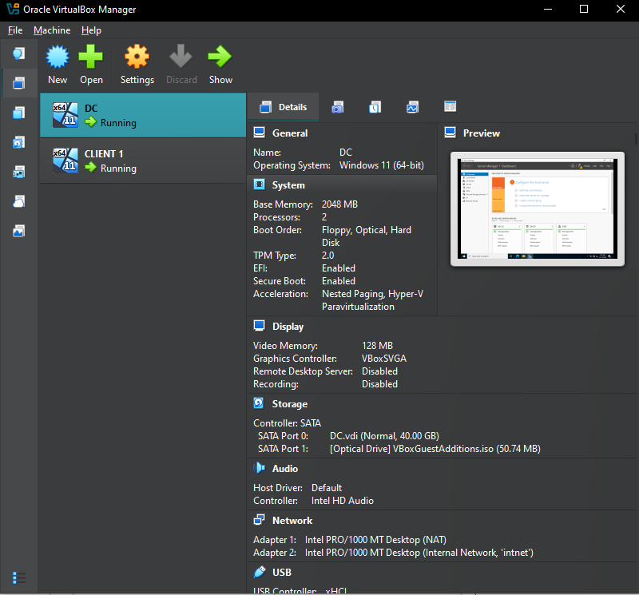
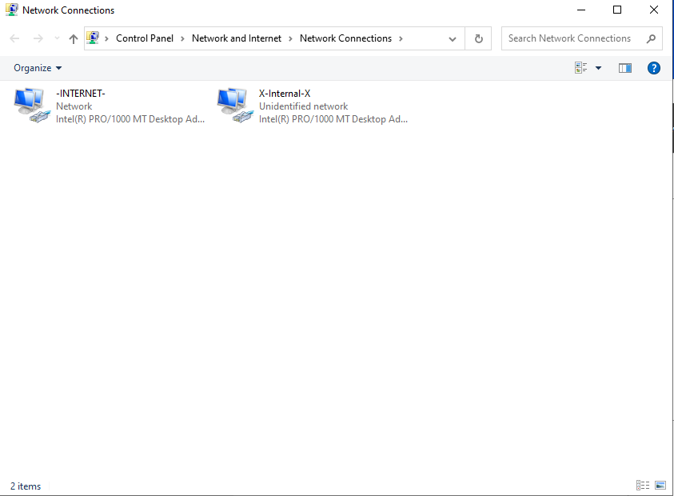
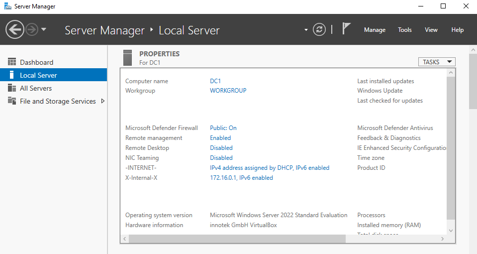
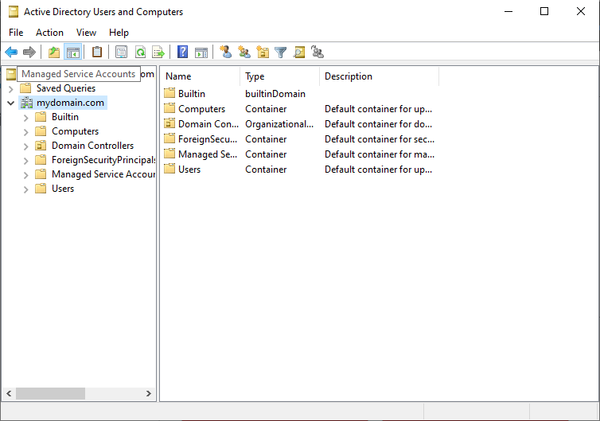
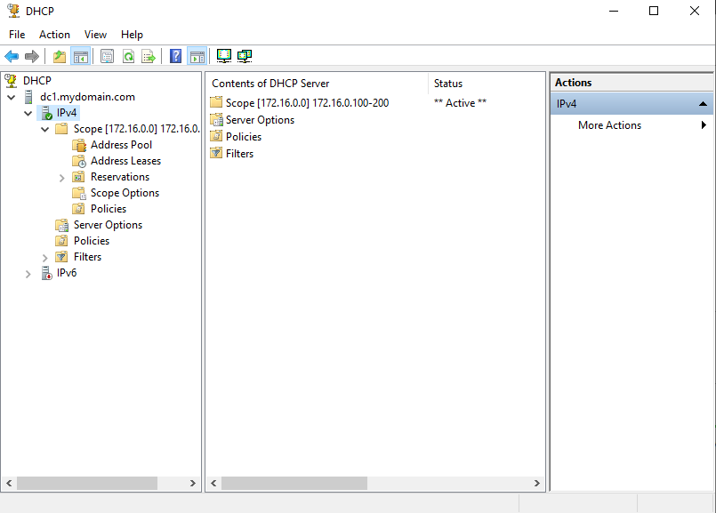
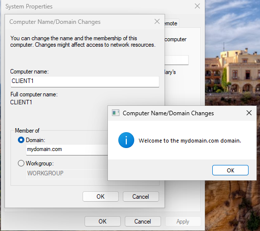
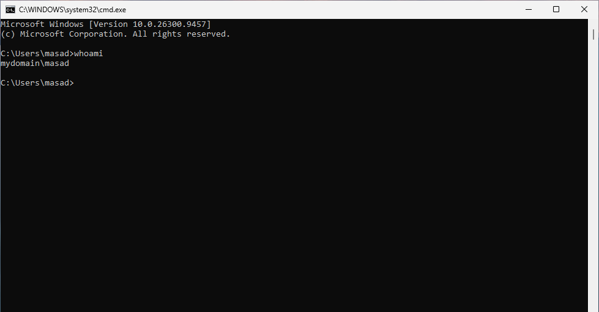

# Active Directory Home Lab

## 1. Project Overview

This project demonstrates the deployment and configuration of an Active Directory home lab using Oracle VirtualBox, Windows Server 2022, and Windows 11.

Windows Server 2022 was configured as a Domain Controller to provide centralized user and domain management. The lab also includes DHCP, DNS, Routing and Remote Access (RRAS) with NAT, and bulk user account creation using PowerShell.

A Windows 11 client virtual machine was connected to the internal network, joined to the Active Directory domain, and tested using a domain user account.

## 2. Lab Environment

The lab was created using Oracle VirtualBox with two virtual machines:

- **Windows Server 2022:** Configured as the Domain Controller.
- **Windows 11:** Configured as the client machine.

The following technologies and services were used:

| Component | Description |
|---|---|
| Virtualization | Oracle VirtualBox |
| Server Operating System | Windows Server 2022 |
| Client Operating System | Windows 11 |
| Directory Service | Active Directory Domain Services |
| Network Services | DNS and DHCP |
| Routing | RRAS and NAT |
| Scripting | Windows PowerShell |

**Virtual Machine Setup**

## 3. Network Configuration

The Domain Controller was configured with two network adapters to connect the internal lab network and external network.

A static IP address was assigned to the server's internal network adapter to provide a consistent address for Active Directory and network services.

The following network settings were used in the lab:

| Setting | Value |
|---|---|
| Domain Name | `mydomain.com` |
| Domain Controller IP | `172.16.0.1` |
| Subnet Mask | `255.255.255.0` |
| DHCP Scope | `172.16.0.100 – 172.16.0.200` |
| Default Gateway | `172.16.0.1` |
| DNS Server | `172.16.0.1` |

*Note: Verify these values against your actual lab configuration before publishing.*

**Server Network Adapter Configuration**

## 4. Server Configuration

Windows Server 2022 was configured with a static IP address on its internal network adapter.

The server was also renamed to prepare it for its role as the Domain Controller.

**Server Configuration**

## 5. Active Directory Installation and Domain Setup

The Active Directory Domain Services (AD DS) role was installed on Windows Server 2022.

The server was then promoted to a Domain Controller, and a new domain was created.

This allowed the server to centrally manage domain users, computers, and authentication.

**Active Directory Domain Setup**

## 6. Organizational Unit and Administrator Configuration

An Organizational Unit (OU) was created to organize and manage domain accounts.

A dedicated administrator account was also created and assigned the appropriate domain administrative permissions.

This provides a structured way to manage users and administrative access within Active Directory.

**Administrator and OU Configuration**

## 7. Routing and NAT Configuration

Routing and Remote Access (RRAS) was configured to provide Network Address Translation (NAT).

The external network adapter was configured for external connectivity, while the internal adapter provided connectivity to the lab network.

This allowed internal client machines to access external networks through the Domain Controller.

**RRAS and NAT Configuration**

## 8. DHCP Configuration

The DHCP Server role was installed and configured to automatically assign IP addresses to client devices.

A DHCP scope was created with an address range for the internal network.

The DHCP configuration also included the appropriate default gateway and DNS server settings.

**DHCP Scope and Network Options**

## 9. Bulk User Creation Using PowerShell

PowerShell was utilized to automate the creation of multiple Active Directory user accounts, making the account provisioning process more efficient.

Script execution permissions were configured before executing the PowerShell script.

Following execution, the newly created user accounts were verified in Active Directory Users and Computers.

**PowerShell Bulk User Creation**

**Active Directory User Accounts**

## 10. Windows 11 Client Configuration and Domain Join

A Windows 11 virtual machine was configured as the client machine.

The client was connected to the internal lab network and configured to obtain its network settings through DHCP.

The assigned IP address and DNS settings were checked to confirm network connectivity.

**Windows 11 Client Network Configuration**

The Windows 11 client was then joined to the Active Directory domain.

After successfully joining the domain, the client became part of the centrally managed network.

**Successful Domain Join**

## 11. Domain Login and Verification

The final step was to verify domain authentication by signing in to the Windows 11 client using a domain user account.

Successful login confirmed that the client could authenticate against the Active Directory Domain Controller.

**Successful Domain User Login**

